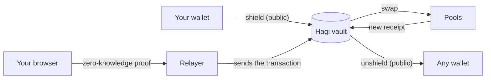

<p align="center">
  
</p>

<p align="center">
  <b>Private swaps, sends and baskets for stock tokens on Robinhood Chain.</b><br>
  <a href="https://hagitrade.xyz">App</a> ·
  <a href="https://hagitrade.xyz/#/docs/overview">Docs</a> ·
  <a href="#deployed-contracts">Contracts</a> ·
  <a href="#hagi">$HAGI</a> ·
  <a href="SECURITY.md">Security</a>
</p>

<p align="center">
  
  
  
  
  
</p>

---

Anyone can read a wallet. Paste an address into an explorer and you get every stock it holds, every amount and every trade, timed to the minute. Hagi takes your portfolio off the record.

You shield tokens into a shared vault. From then on your balance is a set of encrypted receipts that only your key can read. You can swap, send and buy baskets straight from inside the vault, and a relayer sends every transaction, so your wallet never appears on it.

## $HAGI

The official $HAGI token contract on Robinhood Chain:

```
0x4643d8eaa4adc2ce361331b831ea6335742a29a1
```

[Buy on Pons](https://ponsfamily.com/launchpad/0x4643d8eaa4adc2ce361331b831ea6335742a29a1) · [hagitrade.xyz](https://hagitrade.xyz) · [The Oculus](https://oculus.hagitrade.xyz), a live window on every $HAGI burned. This is the only official contract. Anything else using the Hagi name is not us.

<p align="center">
  
  
</p>

## Features

Live on Robinhood Chain testnet at [hagitrade.xyz](https://hagitrade.xyz).

| | |
|---|---|
| **Shield and unshield** | Move USDG or any listed stock token into the vault, and back out to any wallet. |
| **Private swaps** | Trade USDG for a stock, a stock for USDG, or one stock for another, without leaving the vault. No ETH needed for gas. |
| **Private sends** | Pay a Hagi address, a `name.hagi`, or any 0x wallet. Payments to 0x wallets come from the vault, so your wallet stays off them. |
| **Burst sends** | Pay up to 20 people in one go. Paste a list or import a CSV. |
| **Baskets** | Buy a fixed mix of stocks in one private transaction, or create your own. Sell part of a basket or rebalance it later. |
| **Ghost Addresses** | A plain 0x address any wallet or exchange can pay. Claim the deposit straight into your private balance, no wallet or gas needed. |
| **Ghost Swaps** | A Ghost Address tied to a stock, so whatever is sent there arrives as that stock. |
| **Hagi Drops** | Split a pot of stocks into random slices behind one link. First come, first served, and nobody sees who dropped it or who took it. |
| **Hagi names** | Claim a free `name.hagi` and get paid by name instead of a long address. |
| **Phone app and passkeys** | Add Hagi to your home screen and sign in with Face ID or a fingerprint. No wallet needed to start. |
| **Languages** | English, 中文, Español and Français. |
| **Wallet check** | See what anyone can already read about a wallet, straight from public data. |

Listed tokens on testnet: USDG, TSLA, AMD, AMZN, NFLX, PLTR.

## How it works



1. **Receipts.** When you shield, the vault stores a receipt: a commitment to an amount, a token and an owner. Receipts sit in a Merkle tree with room for about a million entries. Your balance is the sum of the receipts you haven't spent.
2. **Proofs.** To spend, your browser builds a Groth16 proof that the receipts exist, that you own them, and that inputs equal outputs. The proof doesn't reveal which receipts are yours.
3. **Relayer.** A relayer submits the transaction and pays the gas, so your wallet is not on it.
4. **Account.** Your Hagi keys come from one wallet signature, so the same wallet always opens the same account. Nothing is stored on a server.

### What's private and what isn't

| Always private | Always public | Never possible |
|---|---|---|
| Your balance and holdings | Deposits into the vault (wallet and amount) | Anyone but you moving your funds |
| Who you pay, and how much | Withdrawals out of the vault (wallet and amount) | An admin taking user funds |
| Who made a swap or bought a basket | Swap sizes and which basket was bought | |

Round amounts and time between shielding and unshielding make the two much harder to connect.

## Repository layout

```
api/                  Relayer and claim endpoints (Vercel serverless functions)
circuits/             Circom transaction circuit and the Groth16 setup script
contracts/
  src/                HagiVault, Verifier, HagiSwap, HagiSwapAdapter, BasketRegistry,
                      HagiGhost, HagiGhostSwap, HagiNames, TestUSDG
  test/               Foundry tests
  script/             Deployment scripts
  e2e/                End-to-end tests and a one-command local stack
  deployments/        Deployed testnet addresses
src/
  engine.ts           Vault client: sync, notes, proofs, relayer calls
  zk/                 Key derivation, note encryption, proving
  store.tsx           App state and polling
  lookup.ts           Wallet check (public data)
  pages/              Landing, Portfolio, Swap, Send, Baskets, Drops, Activity, Docs, Oculus
public/zk/            Circuit wasm and proving key served to the browser
```

## Run it locally

Requirements: Node 20+, and [Foundry](https://book.getfoundry.sh) for the contracts.

**App against testnet**

```bash
npm install
npm run dev
```

**Full local stack** (chain, contracts and relayer in one command)

```bash
npx tsx contracts/e2e/local-stack.ts
# copy the printed config, then:
VITE_HAGI_CONFIG='<printed json>' npm run build && npx vite preview
```

**Contracts**

```bash
cd contracts && npm install
forge test
```

**Circuit** (rebuilds the wasm, proving key and Solidity verifier)

```bash
cd circuits && npm install && ./build.sh
```

## Deployed contracts

Robinhood Chain testnet, chain ID 46630. Full list in [`contracts/deployments/testnet.json`](contracts/deployments/testnet.json).

| Contract | Address |
|---|---|
| HagiVault | [`0x0C3C8c6929851818d6a15A4c57D68F9342B81798`](https://explorer.testnet.chain.robinhood.com/address/0x0C3C8c6929851818d6a15A4c57D68F9342B81798) |
| Groth16Verifier | [`0x75bfE257C0880Aa64C61Cc3DD7B083d7a65606a9`](https://explorer.testnet.chain.robinhood.com/address/0x75bfE257C0880Aa64C61Cc3DD7B083d7a65606a9) |
| HagiSwap (test pools) | [`0xA81738A148743645EB46Ff579CE6E81c63896BE6`](https://explorer.testnet.chain.robinhood.com/address/0xA81738A148743645EB46Ff579CE6E81c63896BE6) |
| HagiSwapAdapter | [`0x1eA488F23337D63EFF469Ea6230eEA4d39Dbb1a6`](https://explorer.testnet.chain.robinhood.com/address/0x1eA488F23337D63EFF469Ea6230eEA4d39Dbb1a6) |
| BasketRegistry | [`0x66D458817B7bCA5655ffB32d5d51770F2C964738`](https://explorer.testnet.chain.robinhood.com/address/0x66D458817B7bCA5655ffB32d5d51770F2C964738) |
| TestUSDG | [`0x48fdc557DE6Fe7efD3341e6c28A626Be021d117a`](https://explorer.testnet.chain.robinhood.com/address/0x48fdc557DE6Fe7efD3341e6c28A626Be021d117a) |
| HagiGhost (Ghost Addresses) | [`0x722445E4a5582FF615aE7f72fc928f62C87d75EF`](https://explorer.testnet.chain.robinhood.com/address/0x722445E4a5582FF615aE7f72fc928f62C87d75EF) |
| HagiGhostSwap (Ghost Swaps) | [`0xEF419424Cd5f73612FbF0212799529052813ec05`](https://explorer.testnet.chain.robinhood.com/address/0xEF419424Cd5f73612FbF0212799529052813ec05) |
| HagiNames (name.hagi) | [`0x3cF6213fa37D19c1Db4492B942A8B53Fc8F3e193`](https://explorer.testnet.chain.robinhood.com/address/0x3cF6213fa37D19c1Db4492B942A8B53Fc8F3e193) |

### Mainnet beta

Robinhood Chain mainnet, chain ID 4663. Recorded in [`contracts/deployments/mainnet.json`](contracts/deployments/mainnet.json). The source for these exact contracts is in [`contracts/src`](contracts/src).

| Contract | Address |
|---|---|
| HagiVault | `0x4450EFCd81DC7d3DfE54f27b351E1FF498437787` |
| Groth16VerifierMainnet | `0xA58CD9eC8324B13a8755337609c767627A96CA21` |
| HagiUniV3Adapter (swaps through Uniswap v3) | `0x0196081E89D79279b0Eb2fd1f13f029f5049Fb72` |

The stock tokens it lists are in [`contracts/deployments/mainnet-tokens.json`](contracts/deployments/mainnet-tokens.json).

**What the owner can and cannot do on mainnet**

- It can pause new deposits and swaps. Pausing never blocks withdrawals or private transfers.
- It can change the deposit limits and which tokens are allowed. A token that was ever allowed can always be withdrawn, even after it is removed.
- It can change the swap adapter. A swap only goes through if the vault receives at least the minimum the user set in their own proof, so a bad adapter can make swaps fail or cost up to the slippage limit, but it cannot take a user's balance.
- It has no function that moves user funds.

**Proving keys.** The mainnet keys were made on a clean CI runner on top of the public perpetual powers-of-tau ceremony, with two rounds of discarded randomness and a public drand beacon. The file hashes are in [`circuits/mainnet-keys.txt`](circuits/mainnet-keys.txt). This is a single-operator setup, not a public ceremony. A multi-party ceremony is planned before the limits are raised.

## Status

**Testnet: live.** Everything in the testnet table runs on Robinhood Chain testnet with test USDG and test pools. Prices come from Hagi's own test pools, not live markets.

**Mainnet beta: deployed, invite-only.**

- Real USDG and stock tokens on Robinhood Chain mainnet
- Core features only: shield, private send, private swap, unshield
- USDG deposits only, capped per wallet and in total
- Access is by whitelist while we test

Hagi has **not been audited** yet, and the proving keys come from a single-operator setup. Don't put in anything you can't afford to lose. Found a problem? See [SECURITY.md](SECURITY.md).

## Roadmap

- [x] Testnet launch: private swaps, sends and baskets
- [x] Phone app, passkeys and languages
- [x] Ghost Addresses, Ghost Swaps, Hagi Drops and Hagi names
- [x] $HAGI live, with buybacks and burns you can watch on [The Oculus](https://oculus.hagitrade.xyz)
- [ ] Mainnet beta with deposit caps
- [ ] Audit and a multi-party proving key ceremony
- [ ] Full mainnet, with the rest of the features carried over

## Contributing

Issues and pull requests are welcome. See [CONTRIBUTING.md](CONTRIBUTING.md).
