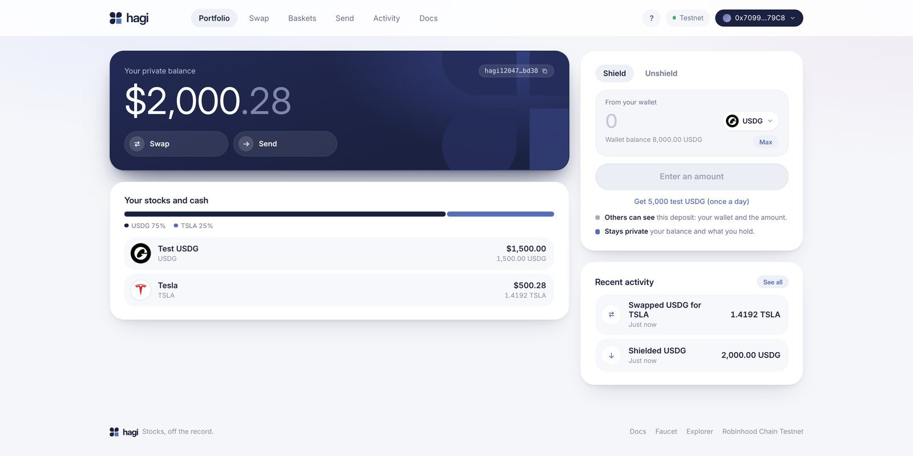
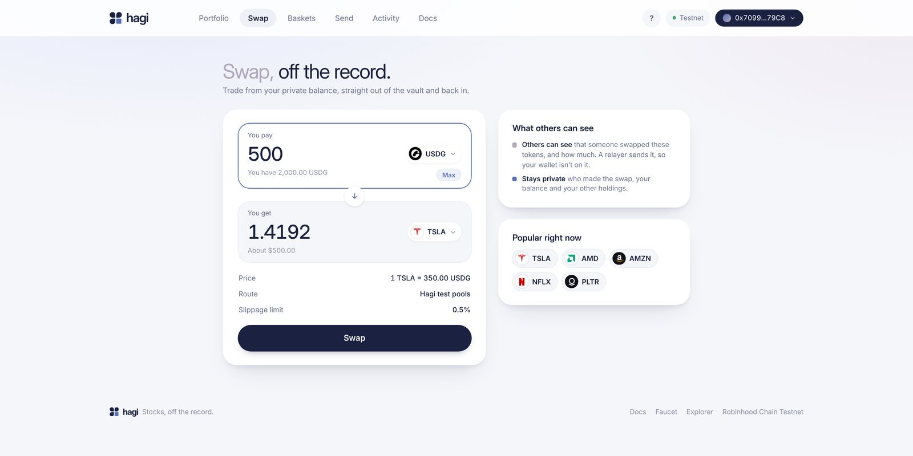
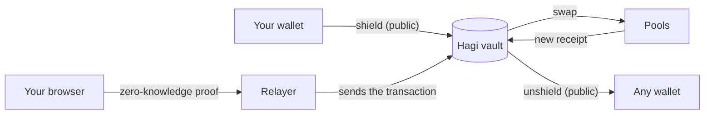

<p align="center">
  
</p>

<p align="center">
  <b>Private swaps, sends and baskets for stock tokens on Robinhood Chain.</b><br>
  <a href="https://hagitrade.xyz">App</a> ·
  <a href="https://hagitrade.xyz/#/docs/overview">Docs</a> ·
  <a href="#deployed-contracts">Contracts</a> ·
  <a href="SECURITY.md">Security</a>
</p>

<p align="center">
  
  
  
</p>

---

Anyone can read a wallet. Paste an address into an explorer and you get every stock it holds, every amount and every trade, timed to the minute. Hagi takes your portfolio off the record.

You shield tokens into a shared vault. From then on your balance is a set of encrypted receipts that only your key can read. You can swap, send and buy baskets straight from inside the vault, and a relayer sends every transaction, so your wallet never appears on it.

<p align="center">
  
  
</p>

## Features

| | |
|---|---|
| **Shield and unshield** | Move USDG or any listed stock token into the vault, and back out to your wallet. |
| **Private swaps** | Trade USDG for a stock, a stock for USDG, or one stock for another, without leaving the vault. No ETH needed for gas. |
| **Private sends** | Pay any Hagi address (`hagi1…`). The token, the amount and both sides stay private. |
| **Baskets** | Buy a fixed mix of stocks in one private transaction, or create your own. Baskets can't be changed once made. |
| **Wallet check** | See what anyone can already read about a wallet, straight from public data. |
| **No wallet to look around** | The app opens without a wallet, with a guided tour. Connect when you're ready. |

Listed tokens on testnet: USDG, TSLA, AMD, AMZN, NFLX, PLTR.

## How it works



1. **Receipts.** When you shield, the vault stores a receipt: a commitment to an amount, a token and an owner. Receipts sit in a Merkle tree with room for about a million entries. Your balance is the sum of the receipts you haven't spent.
2. **Proofs.** To spend, your browser builds a Groth16 proof that the receipts exist, that you own them, and that inputs equal outputs. The proof doesn't reveal which receipts are yours.
3. **Relayer.** A relayer submits the transaction and pays the gas, so your wallet is not on it.
4. **Account.** Your Hagi keys come from one wallet signature, so the same wallet always opens the same account. Nothing is stored on a server.

The design is adapted from Tornado Nova (2-in, 2-out transactions with encrypted notes), extended with swaps through a pool adapter and basket buys.

### What's private and what isn't

| Always private | Always public | Never possible |
|---|---|---|
| Your balance and holdings | Deposits into the vault (wallet and amount) | Anyone but you moving your funds |
| Who you pay, and how much | Withdrawals out of the vault (wallet and amount) | An admin taking user funds |
| Who made a swap or bought a basket | Swap sizes and which basket was bought | |

Round amounts and time between shielding and unshielding make the two much harder to connect.

## Repository layout

```
api/relay.ts          Relayer, deployed as a Vercel serverless function
circuits/             Circom transaction circuit and the Groth16 setup script
contracts/
  src/                HagiVault, Verifier, HagiSwap, HagiSwapAdapter, BasketRegistry, TestUSDG
  test/               Foundry tests
  script/             Deployment scripts
  e2e/                End-to-end tests and a one-command local stack
  deployments/        Deployed testnet addresses
src/
  engine.ts           Vault client: sync, notes, proofs, relayer calls
  zk/                 Key derivation, note encryption, proving
  store.tsx           App state and polling
  lookup.ts           Wallet check (public data)
  pages/              Landing, Portfolio, Swap, Send, Baskets, Activity, Docs
public/zk/            Circuit wasm and proving key served to the browser
```

## Run it locally

Requirements: Node 20+, and [Foundry](https://book.getfoundry.sh) for the contracts.

**App against testnet**

```bash
npm install
npm run dev
```

**Full local stack** (chain, contracts and relayer in one command)

```bash
npx tsx contracts/e2e/local-stack.ts
# copy the printed config, then:
VITE_HAGI_CONFIG='<printed json>' npm run build && npx vite preview
```

**Contracts**

```bash
cd contracts && npm install
forge test
```

**Circuit** (rebuilds the wasm, proving key and Solidity verifier)

```bash
cd circuits && npm install && ./build.sh
```

## Deployed contracts

Robinhood Chain testnet, chain ID 46630. Full list in [`contracts/deployments/testnet.json`](contracts/deployments/testnet.json).

| Contract | Address |
|---|---|
| HagiVault | [`0x0C3C8c6929851818d6a15A4c57D68F9342B81798`](https://explorer.testnet.chain.robinhood.com/address/0x0C3C8c6929851818d6a15A4c57D68F9342B81798) |
| Groth16Verifier | [`0x75bfE257C0880Aa64C61Cc3DD7B083d7a65606a9`](https://explorer.testnet.chain.robinhood.com/address/0x75bfE257C0880Aa64C61Cc3DD7B083d7a65606a9) |
| HagiSwap (test pools) | [`0xA81738A148743645EB46Ff579CE6E81c63896BE6`](https://explorer.testnet.chain.robinhood.com/address/0xA81738A148743645EB46Ff579CE6E81c63896BE6) |
| HagiSwapAdapter | [`0x1eA488F23337D63EFF469Ea6230eEA4d39Dbb1a6`](https://explorer.testnet.chain.robinhood.com/address/0x1eA488F23337D63EFF469Ea6230eEA4d39Dbb1a6) |
| BasketRegistry | [`0x66D458817B7bCA5655ffB32d5d51770F2C964738`](https://explorer.testnet.chain.robinhood.com/address/0x66D458817B7bCA5655ffB32d5d51770F2C964738) |
| TestUSDG | [`0x48fdc557DE6Fe7efD3341e6c28A626Be021d117a`](https://explorer.testnet.chain.robinhood.com/address/0x48fdc557DE6Fe7efD3341e6c28A626Be021d117a) |

## Status

Hagi is a testnet build. Don't use it with anything you can't afford to lose.

- The contracts and circuit have **not been audited**.
- The proving key comes from a **single-party setup**. A public multi-party ceremony is required before mainnet.
- Prices come from Hagi's own test pools, seeded at rough prices. They are not live market prices.

Found a problem? See [SECURITY.md](SECURITY.md).

## Roadmap

- Testnet season: feedback, relayer hardening, a status page
- Mainnet build: real USDG and stock tokens, routing through Robinhood Chain's live pools, relayer fees, deposit caps
- Security: multi-party ceremony, circuit and contract audits, bug bounty
- Guarded mainnet beta

## Contributing

Issues and pull requests are welcome. See [CONTRIBUTING.md](CONTRIBUTING.md).
